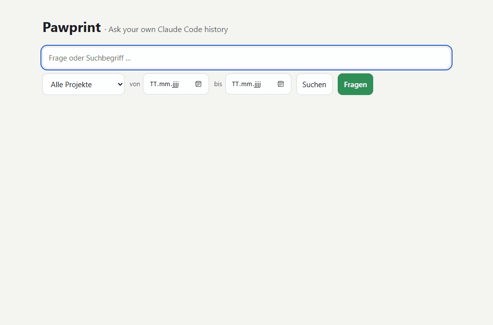
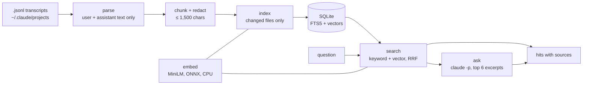

# Pawprint

**Ask your own Claude Code history.**

Pawprint indexes the session transcripts that Claude Code keeps in `~/.claude/projects/`,
lets you search them by keyword and by meaning, and answers questions in plain language
with the sessions it took the answer from. Search and embeddings run on your machine.



*The demo runs on invented sessions from `scripts/make_demo.py`, not on real chats.*

## What it does

- **Finds old decisions and fixes.** "How did I fix the login redirect?" returns the turns where it happened, with date, project and session title.
- **Searches across languages.** A German question finds an English answer and the other way round (multilingual embeddings).
- **Answers with sources.** `pawprint ask` sends the best few excerpts to `claude -p` and the answer cites them as `[Quelle n]`. If the excerpts don't cover the question, it says so instead of guessing.
- **Stays local.** One SQLite file holds the index. Only the excerpts used for an answer leave your machine, and only when you ask.

## Quick start

Needs Python 3.11+. `ask` and the answer button also need a logged-in [Claude Code](https://claude.com/claude-code) CLI; search works without it.

```
git clone https://github.com/krissrsch/pawprint
cd pawprint
python -m venv .venv
.venv/Scripts/pip install -e .          # macOS/Linux: .venv/bin/pip

pawprint index                          # first run: about a minute for ~4,000 chunks
pawprint search "how did I fix the login redirect"
pawprint ask "why did we pick SQLite over Postgres?"
pawprint serve                          # web UI, prints a link with a one-time token
```

The first `index` downloads the embedding model (about 220 MB). Later runs only read
transcripts that changed and finish in about a second.

### Try it without your own history

```
python scripts/make_demo.py demo
PAWPRINT_HOME=demo pawprint index --root demo/projects
PAWPRINT_HOME=demo pawprint serve
```

## How it works



1. **Parse.** Each transcript line is JSON. Pawprint keeps what you typed and what the assistant wrote. Tool output, thinking blocks and injected wrappers are dropped. Slash commands keep their arguments (`/dev fix the login`). The format is undocumented, so unknown line types are counted and skipped, never fatal.
2. **Chunk and redact.** A question plus its answer becomes one chunk, split at paragraphs above 1,500 characters. API keys, tokens, private keys, passwords in URLs and `KEY=value` secrets are replaced with `[REDACTED]` before anything is stored.
3. **Index.** Chunks go into SQLite with an FTS5 keyword index and a float32 vector per chunk. A file is re-read only when its size or modification time changed, and unchanged text keeps its vector (matched by hash).
4. **Search.** Keyword search (bm25) and vector search (cosine) each return their top 50; Reciprocal Rank Fusion merges the two rankings. Filters for project and date apply before ranking.
5. **Ask.** The top 6 excerpts are redacted again, numbered and sent to `claude -p` with no tools, no settings and no session saved. The prompt tells Claude to answer only from the excerpts, cite them, treat them as data rather than instructions, and say "Nicht gefunden" when they don't contain the answer.

## How well it finds things

Measured on the author's own history (240 transcripts, 3,681 chunks). A hit means the right
session is among the first five sessions returned.

| Question set | Keyword | Vector | Hybrid |
|---|---|---|---|
| 30 questions, German, close to the original wording | 0.97 | 0.77 | **0.97** |
| 10 questions, English, paraphrased, about German sessions | 0.60 | 0.80 | **0.80** |

The questions themselves stay private because they come from personal sessions. The larger
`multilingual-e5-large` model scored about the same (36 of 40 against 37 of 40) at 30 times
the indexing time, so the small model is the default. Details, costs and open points:
[eval/RESULTS.md](eval/RESULTS.md).

## Privacy and security

- Your transcripts are read, never written. The index lives in `~/.pawprint/`, outside the repository.
- Secrets are redacted before indexing and again before anything is sent to Claude.
- `pawprint serve` binds to 127.0.0.1 only. The printed link carries a random token after the `#`, so it never reaches the server log. Requests without the token get 401, and requests with a foreign `Host` header get 403, which blocks DNS-rebinding attacks from other websites.
- The page inserts excerpts as text, never as HTML, because they are content from old chats.
- This repository contains only invented test data. A test in CI fails if a real transcript, an index file or a private evaluation file is ever committed.

## Configuration

| Variable | Default | Meaning |
|---|---|---|
| `PAWPRINT_HOME` | `~/.pawprint` | Where the index files are stored |
| `PAWPRINT_MODEL` | `sentence-transformers/paraphrase-multilingual-MiniLM-L12-v2` | Embedding model ([fastembed](https://github.com/qdrant/fastembed) name); each model gets its own index file |

## Limitations

- The Claude Code transcript format is not documented and may change. The parser is tolerant, but new formats can hide text until it is updated.
- MiniLM reads only the first 128 tokens of a chunk, so the question at the start of a chunk weighs more than the end of a long answer.
- Vector search is brute force over all chunks. That is fast for tens of thousands of chunks; beyond that it would need a vector index.
- The web UI labels are German.

## Development

```
.venv/Scripts/pip install -e .[dev]
.venv/Scripts/python -m pytest -q
.venv/Scripts/python eval/run_eval.py                 # needs your own eval/private/questions.json
```

CI runs the tests on Ubuntu and Windows with Python 3.11 and 3.13.

## License

MIT
