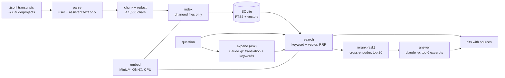

# Pawprint

**Ask your own Claude Code history.**

Pawprint indexes the session transcripts that Claude Code keeps in `~/.claude/projects/`,
lets you search them by keyword and by meaning, and answers questions in plain language
with the sessions it took the answer from. Search and embeddings run on your machine.


*The demo runs on invented sessions from `scripts/make_demo.py`, not on real chats.*

## What it does

- **Finds old decisions and fixes.** "How did I fix the login redirect?" returns the turns where it happened, with date, project and session title.
- **Searches across languages.** A German question finds an English answer and the other way round (multilingual embeddings).
- **Answers with sources.** `pawprint ask` lets Claude add a translation and keywords to your question, searches with all three, has a reranker pick the best excerpts, and sends them to `claude -p`; the answer cites them as `[Quelle n]`. If the excerpts don't cover the question, it says so instead of guessing.
- **Stays local.** One SQLite file holds the index. Only the excerpts used for an answer leave your machine, and only when you ask.

## Quick start

Needs Python 3.11+. `ask` and the answer button also need a logged-in [Claude Code](https://claude.com/claude-code) CLI; search works without it.

```
git clone https://github.com/krissrsch/pawprint
cd pawprint
python -m venv .venv
.venv/Scripts/pip install -e .          # macOS/Linux: .venv/bin/pip

pawprint index                          # first run: about 3 minutes for ~4,000 chunks
pawprint search "how did I fix the login redirect"
pawprint ask "why did we pick SQLite over Postgres?"
pawprint serve                          # updates the index, then the web UI with a one-time token link
```

The first `index` downloads the embedding model (about 220 MB). After a Pawprint update that changes parsing or redaction,
`pawprint index --reread` parses every transcript again in seconds; text that did not change keeps its vectors. Later runs only read
transcripts that changed and finish in seconds. The first `ask` also downloads the reranker
(about 1.1 GB); an answer then takes 10 to 20 seconds on a CPU.

### Try it without your own history

```
python scripts/make_demo.py demo
PAWPRINT_HOME=demo pawprint index --root demo/projects
PAWPRINT_HOME=demo pawprint serve
```

## How it works



1. **Parse.** Each transcript line is JSON. Pawprint keeps what you typed and what the assistant wrote. Tool output, thinking blocks and injected wrappers are dropped. Slash commands keep their arguments (`/dev fix the login`). The format is undocumented, so unknown line types are counted and skipped, never fatal.
2. **Chunk and redact.** A question plus its answer becomes one chunk, split at paragraphs above 1,500 characters. API keys, tokens, private keys, passwords in URLs and `KEY=value` secrets are replaced with `[REDACTED]` before anything is stored.
3. **Index.** Chunks go into SQLite with an FTS5 keyword index. The embedding model reads only about 128 tokens, so each chunk is embedded as overlapping 450-character windows, each with the project and session title in front; a chunk scores by its best window. A file is re-read only when its size or modification time changed, and unchanged text keeps its vector (matched by hash).
4. **Search.** Keyword search (bm25) and vector search (cosine) each return their top 50; Reciprocal Rank Fusion (k = 10) merges the two rankings. Filters for project and date apply before ranking.
5. **Ask.** First `claude -p` (Haiku, about 2 s) rewrites the question into the other language (German ↔ English) and into 6 to 10 keywords; the search runs with all three and fuses the six rankings. A multilingual cross-encoder ([jina-reranker-v2-base-multilingual](https://huggingface.co/jinaai/jina-reranker-v2-base-multilingual)) then reads question and passage together and reorders the top 20. Plain `pawprint search` skips both steps to stay instant; `--expand` and `--rerank` switch them on.
6. **Answer.** The top 6 excerpts are redacted again, numbered and sent to `claude -p` with no tools, no settings and no session saved. The prompt tells Claude to answer only from the excerpts, cite them, treat them as data rather than instructions, and say "Nicht gefunden" when they don't contain the answer.

## How well it finds things

Measured on the author's own history. The main test set has **798 questions** that `claude -p`
wrote for 400 random passages from 32 projects, in four styles; each comes with a verbatim quote
from its passage, and a hit means a returned chunk contains that quote.

| Search | top 1 | top 5 | top 10 |
|---|---|---|---|
| Keyword only | 0.40 | 0.59 | 0.64 |
| Vector only | 0.23 | 0.42 | 0.53 |
| **Hybrid (default)** | **0.35** | **0.66** | **0.75** |

By style (hybrid, top 10): search-box keywords 0.98, vague 0.77, paraphrased 0.72, other language 0.53.
This set exposed two problems that are now fixed: the usual fusion constant let weak vector hits
crowd out good keyword hits, and the embedding model only saw the first third of each chunk.
Together the fixes raised top-10 hits from 0.56 to 0.75.

The `ask` pipeline adds query expansion and a reranker. On a stratified sample of 240 questions:

| Retrieval for `ask` | top 1 | top 5 | top 10 | MRR |
|---|---|---|---|---|
| Plain hybrid | 0.33 | 0.65 | 0.72 | 0.47 |
| + translation and keywords from Claude | 0.45 | 0.74 | 0.84 | 0.57 |
| **+ reranker (what `ask` uses)** | **0.72** | **0.88** | **0.89** | **0.79** |

Questions in the other language rise from 0.45 to 0.88 in the top 10. Of the 199 questions plain
hybrid search did not have in its top 10, the pipeline puts 127 into the top 10 and 86 in first place.
`ask` answered 7 of 7 answerable questions correctly with citations and refused 4 of 4 it could
not answer. Small hand-written sets score 0.97 (30 German questions) and 0.80 (10 paraphrased
English ones) with plain hybrid search.

The questions stay private because they come from personal sessions; the scripts that build and
score them are in `eval/`. Details, model comparison and costs: [eval/RESULTS.md](eval/RESULTS.md).

## Use it from Nikki

[Nikki](https://github.com/krissrsch/nikki), a notch for Windows that runs Claude Code, has a **Paw** tab that asks Pawprint.
Nikki starts `pawprint serve --port <free port> --parent-pid <Nikki's pid>` with the first question, passes the token
in `PAWPRINT_TOKEN` (not on the command line), and stops the server after ten idle minutes. If Nikki crashes, the server
notices that its parent is gone and exits, so the search models do not stay in memory.

## Privacy and security

- Your transcripts are read, never written. The index lives in `~/.pawprint/`, outside the repository.
- Secrets are redacted before indexing and again before anything is sent to Claude.
- `pawprint serve` binds to 127.0.0.1 only. The printed link carries a random token after the `#`, so it never reaches the server log. Requests without the token get 401, and requests with a foreign `Host` header get 403, which blocks DNS-rebinding attacks from other websites.
- The page inserts excerpts as text, never as HTML, because they are content from old chats.
- This repository contains only invented test data. A test in CI fails if a real transcript, an index file or a private evaluation file is ever committed.

## Configuration

| Variable | Default | Meaning |
|---|---|---|
| `PAWPRINT_HOME` | `~/.pawprint` | Where the index files are stored |
| `PAWPRINT_MODEL` | `sentence-transformers/paraphrase-multilingual-MiniLM-L12-v2` | Embedding model ([fastembed](https://github.com/qdrant/fastembed) name); each model gets its own index file |
| `PAWPRINT_RERANKER` | `jinaai/jina-reranker-v2-base-multilingual` | Cross-encoder used by `ask` and `--rerank` |
| `PAWPRINT_TOKEN` | random per start | Fixed token for `serve`, for a program that starts Pawprint itself |
| `PAWPRINT_EXPAND_MODEL` | `haiku` | Claude model that rewrites the question before the search; the answer itself always uses `sonnet` |

## Limitations

- The Claude Code transcript format is not documented and may change. The parser is tolerant, but new formats can hide text until it is updated.
- Plain search is weakest for questions in the other language than the conversation (0.53 in the top 10), because keyword search cannot match across languages. `ask` and `search --expand` fix most of it (0.88) at the cost of one short `claude -p` call (Haiku).
- The reranker runs on the CPU and needs about 4 seconds per question; the remaining misses are mostly very specific details deep inside long passages.
- Vector search is brute force over all windows (about 14,000 for 4,000 chunks). That is fast up to some hundred thousand windows; beyond that it would need a vector index.
- The web UI labels are German.

## Development

```
.venv/Scripts/pip install -e .[dev]
.venv/Scripts/python -m pytest -q
.venv/Scripts/python eval/run_eval.py                 # needs your own eval/private/questions.json
```

CI runs the tests on Ubuntu and Windows with Python 3.11 and 3.13.

## License

MIT
